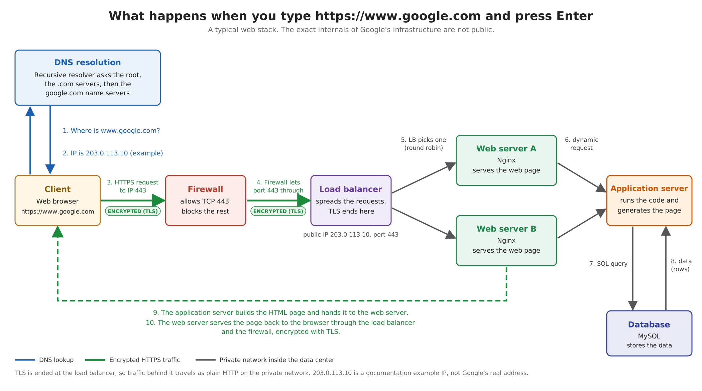

# What happens when you type https://www.google.com in your browser and press Enter

A classic interview question: explain, layer by layer, what happens between pressing Enter on `https://www.google.com` and seeing the page. This project is a blog post plus a diagram of the full request flow.

## Topics covered

- DNS request
- TCP/IP
- Firewall
- HTTPS/SSL
- Load balancer
- Web server
- Application server
- Database

## Files

| File | Description |
|------|-------------|
| [0-blog_post](./0-blog_post) | URL of the published blog post (Medium or LinkedIn) |
| [1-what_happen_when_diagram](./1-what_happen_when_diagram) | URL of the diagram image |
| [blog_post_draft.md](./blog_post_draft.md) | Full text of the blog post |
| [diagram.png](./diagram.png) | The diagram (image) |
| [diagram.svg](./diagram.svg) | Editable source of the diagram |

## Diagram

The diagram shows:

- DNS resolution (steps 1 and 2)
- The request reaching the server IP on port 443 (step 3)
- Encrypted traffic (TLS), marked in green
- The traffic going through a firewall (step 4)
- The request being distributed by a load balancer (step 5)
- The web server answering by serving a web page
- The application server generating the page (step 6)
- The application server requesting data from the database (steps 7 and 8)
- The page returning to the browser (steps 9 and 10)

## Notes

- Everything is written in English.
- The IP `203.0.113.10` in the diagram is a documentation example, not Google's real address. Google's real infrastructure is private, so the post describes a typical web stack.
